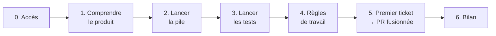

# Rejoindre Luniqo

Le parcours d'un nouvel arrivant, du premier accès à sa première PR fusionnée.
Il s'adresse à un développeur qui rejoint l'équipe, stagiaire compris.

Ce fichier ne recopie pas la documentation : il dit **dans quel ordre** la lire
et **comment vérifier** que chaque étape a marché. Si une étape échoue, le
signaler à l'équipe : un onboarding qui bloque est un défaut du projet, pas du
nouvel arrivant.

## Le parcours en un coup d'œil



| Étape | Durée indicative | Terminée quand |
|---|---|---|
| [0. Accès](#0-obtenir-les-accès) | 15 min | GitHub et Jira s'ouvrent sur le projet |
| [1. Comprendre le produit](#1-comprendre-le-produit) | 45 min | on sait expliquer le parcours central et les 4 rôles |
| [2. Lancer la pile](#2-lancer-la-pile-docker) | 30 min | `/api/health` répond et Swagger s'affiche |
| [3. Lancer les tests](#3-lancer-les-tests-de-lapi) | 30 min | `pytest` est vert, avec la base de test |
| [4. Règles de travail](#4-apprendre-les-règles-de-travail) | 30 min | on sait nommer une branche et ce que contient une PR |
| [5. Premier ticket](#5-premier-ticket--de-la-branche-à-la-pr-fusionnée) | selon le ticket | la PR est fusionnée dans `develop` |
| [6. Bilan](#6-bilan-de-fin-de-stage) | 1 h | rapport rendu, retour du maître de stage reçu |

## 0. Obtenir les accès

| Outil | Pour | Comment l'obtenir | Vérifier |
|---|---|---|---|
| GitHub, dépôt [`zharrow/Luniqo`](https://github.com/zharrow/Luniqo) | code, PR, CI | invitation envoyée par Florent | le dépôt s'ouvre, l'onglet *Actions* est visible |
| Jira, projet **LUN** | tickets, board, versions | invitation envoyée par Florent | son ticket apparaît dans le board et peut être commenté |
| Docker avec Compose v2 | lancer toute la pile | installation locale | `docker compose version` affiche une version 2 |
| Python 3.14 | tests de l'API | installation locale | `python3 --version` |

L'équipe et qui relit quoi :

| Membre | Rôle | Le solliciter pour |
|---|---|---|
| Florent | Chef de projet | accès, priorités, contenu d'un ticket, recette |
| Thomas | Développeur fullstack | relecture front et back |
| Pauline | Développeuse frontend | relecture front, design system |
| Julien | Développeur backend | relecture API, base de données |

## 1. Comprendre le produit

Lire dans cet ordre :

1. [README.md](README.md), section **Le projet** : d'où vient Luniqo, le parcours
   central, les 4 rôles, les deux versions (v1 gelée, v2 en cours).
2. [docs/produit/PERSONAS.md](docs/produit/PERSONAS.md) : pour qui on construit.
3. [docs/produit/STORY-MAP.md](docs/produit/STORY-MAP.md) : ce que contient le MVP
   et ce qui vient après.
4. [ADR-001](M2/decisions/ADR-001-reecriture-backend.md) : pourquoi la v2 existe.

**Vérifier** : savoir répondre sans relire à ces trois questions.

- Que se passe-t-il quand un employé pointe le départ d'un enfant ?
- Quelle différence entre `owner`, `employee`, `guardian` et `developer` ?
- Où vit la logique métier en v2, et pourquoi pas dans le navigateur ?

## 2. Lancer la pile Docker

Suivre l'**option 1** du [README](README.md#option-1--toute-la-pile-avec-docker-le-plus-simple) :

```bash
git clone https://github.com/zharrow/Luniqo.git
cd Luniqo
git switch develop
cd docker
docker compose up -d --build
docker compose ps
```

**Vérifier** :

- [ ] `docker compose ps` montre `db`, `api` et `web` à l'état `healthy` ;
- [ ] <http://localhost:8080> affiche la page de connexion du front v2 ;
- [ ] <http://localhost:8080/api/health> répond ;
- [ ] <http://localhost:8080/api/docs> affiche la documentation Swagger de l'API.

Pour se connecter avec des comptes de démonstration, créer le fichier `.env`
décrit dans le README (variable `API_SEED_DEMO_PASSWORD`). Les données sont
**synthétiques**, avec des adresses en `.test`.

| Problème fréquent | Cause | Solution |
|---|---|---|
| Un service reste `unhealthy` | il attend la base ou l'API | `docker compose logs <service>` |
| Le port 8080 est déjà pris | un autre programme l'utilise | l'arrêter, ou lancer avec un autre port : `WEB_PUBLISHED_PORT=8081 docker compose up -d` |
| La page de connexion de la v1 échoue | variables Supabase absentes | normal sans `.env` ; la v2 se teste par Swagger |

Le détail de la conteneurisation (images, limites, ordre de démarrage) est dans
[docker/README.md](docker/README.md).

## 3. Lancer les tests de l'API

Suivre l'**option 2** du [README](README.md#option-2--travailler-sur-lapi-v2) :
environnement virtuel, `pytest` sans base, puis avec la base PostgreSQL jetable
(`scripts/test-db.sh up`), et `ruff check .`.

**Vérifier** :

- [ ] `pytest` est vert sans base (tests unitaires) ;
- [ ] `pytest` est vert avec `TEST_DB_*` exporté (unitaires et intégration) ;
- [ ] `ruff check .` ne signale rien.

C'est exactement ce que fait la CI ([ci.yml](.github/workflows/ci.yml)) : si
c'est vert en local, la CI le sera aussi. Lire ensuite [api/README.md](api/README.md)
pour la structure de l'API, ses routes et qui accède à quoi.

## 4. Apprendre les règles de travail

Lire [CONTRIBUTING.md](CONTRIBUTING.md) en entier. L'essentiel :

| Sujet | Règle |
|---|---|
| Ticket | Tout travail part d'un ticket `LUN-<n>` dans Jira |
| Branche | `<préfixe>/LUN-<n>-description-courte`, depuis `develop` ; préfixes `feat/`, `fix/`, `docs/`, `infra/`, `chore/` |
| Commit | [Conventional Commits](https://www.conventionalcommits.org/fr/v1.0.0/) en français, clé en fin de ligne : `feat(api): pointage groupé (LUN-65)` |
| PR | vers `develop`, titre au format d'un commit, [modèle](.github/pull_request_template.md) rempli, une PR par ticket |
| Relecture | au moins une personne ; front par Pauline ou Thomas, back par Julien ou Thomas |
| Fini | la [Definition of Done](CONTRIBUTING.md#5-definition-of-done) est cochée |

Les statuts Jira **avancent seuls** : créer la branche passe le ticket « En
cours », ouvrir la PR le passe « En revue », la fusion le passe « Intégré ». On ne
déplace donc pas son ticket à la main ; on le commente pour signaler un blocage.
Le fonctionnement complet est dans [docs/projet/JIRA.md](docs/projet/JIRA.md).

Trois règles ne se discutent pas ([CONTRIBUTING, §6](CONTRIBUTING.md#6-règles-propres-au-projet)) :

- **la v1 est gelée** : on ne modifie la racine du dépôt (Next.js) que pour un correctif de sécurité ;
- **données synthétiques uniquement** : jamais de vraies données d'enfants, de familles ou de salariés, le dépôt est public ;
- **aucun secret dans le dépôt** : mots de passe et clés dans des `.env` non versionnés.

**Vérifier** : la CI refuse une branche mal nommée ou une PR sans clé
([pr-conventions.yml](.github/workflows/pr-conventions.yml)). Savoir dire quel
nom aurait la branche du ticket LUN-65 « mode tablette » (`feat/LUN-65-mode-tablette`).

## 5. Premier ticket : de la branche à la PR fusionnée

Le premier ticket est attribué dans Jira par le chef de projet. Pour un stage,
c'est une story fullstack : une partie API, une partie interface, des tests.

1. **Lire le ticket** et ses critères d'acceptation. Poser ses questions en
   commentaire du ticket, pas en message privé : la réponse profite à tous.
2. **Créer la branche** depuis `develop` à jour :
   ```bash
   git switch develop && git pull
   git switch -c feat/LUN-<n>-description-courte
   git push -u origin feat/LUN-<n>-description-courte   # le ticket passe « En cours »
   ```
3. **Coder côté API** en suivant la structure décrite dans [api/README.md](api/README.md).
   Toute route d'une crèche passe par les dépendances d'accès (`ReadableNursery`,
   `ManagedNursery`) : c'est ce qui isole les données d'une crèche à l'autre.
4. **Coder côté interface** en respectant le design system :
   [docs/DESIGN-SYSTEM.md](docs/DESIGN-SYSTEM.md) (palette « Douceur
   Professionnelle », composants shadcn/ui) et [docs/COMPONENTS.md](docs/COMPONENTS.md).
   Le choix technique du front v2 est expliqué dans
   [ADR-002](M2/decisions/ADR-002-front-v2.md).
5. **Écrire les tests** qui prouvent la nouvelle règle, y compris les cas
   d'erreur (accès refusé, donnée invalide).
6. **Mettre à jour la documentation** : README de l'API si une route change,
   ligne dans [CHANGELOG.md](CHANGELOG.md) section « Non publié ».
7. **Ouvrir la PR** vers `develop` avec le titre `feat(…): … (LUN-<n>)` et le
   modèle rempli. Le ticket passe « En revue ».
8. **Traiter la relecture** : répondre à chaque commentaire, pousser les
   corrections sur la même branche. Une fois approuvée et la CI verte, la PR est
   fusionnée ; le ticket passe « Intégré ».

**Checklist avant de demander une relecture** :

- [ ] la branche part de `develop` et porte la clé du ticket ;
- [ ] `pytest` et `ruff check .` sont verts en local ;
- [ ] le parcours touché a été rejoué sur la pile Docker ;
- [ ] les cas d'erreur sont gérés et testés, avec un message utile à l'utilisateur ;
- [ ] l'interface suit le design system ;
- [ ] la documentation et le CHANGELOG sont à jour ;
- [ ] le modèle de PR est rempli, cases cochées honnêtement.

## 6. Bilan de fin de stage

Le stage se termine par deux retours écrits.

| Qui | Rédige | Contenu |
|---|---|---|
| Le stagiaire | un rapport de stage | ce qui a été livré (ticket, PR), ce qui a aidé, ce qui a bloqué, les étapes de ce parcours à améliorer |
| Le maître de stage | un retour sur le stage | respect des pratiques du projet, qualité de la PR et des tests, autonomie, points à travailler |

Chaque blocage relevé dans le rapport devient un ticket pour améliorer ce
fichier ou la documentation qu'il cite.

## Où trouver quoi

| Besoin | Document |
|---|---|
| Installer, lancer, comprendre le produit | [README.md](README.md) |
| Branches, versions, commits, PR, Definition of Done | [CONTRIBUTING.md](CONTRIBUTING.md) |
| Routes de l'API, structure, configuration | [api/README.md](api/README.md), Swagger sur `/api/docs` |
| Pile Docker | [docker/README.md](docker/README.md) |
| Jira : workflow, automatisations, lien avec GitHub | [docs/projet/JIRA.md](docs/projet/JIRA.md) |
| Personas, story map | [docs/produit/](docs/produit/) |
| Choix techniques et leurs raisons | [M2/decisions/](M2/decisions/) |
| Ce qui a changé d'une version à l'autre | [CHANGELOG.md](CHANGELOG.md) |

Le dossier `docs/` (hors `docs/produit/` et `docs/projet/`) contient la
documentation historique de la v1 ; elle n'est pas nécessaire pour démarrer.
