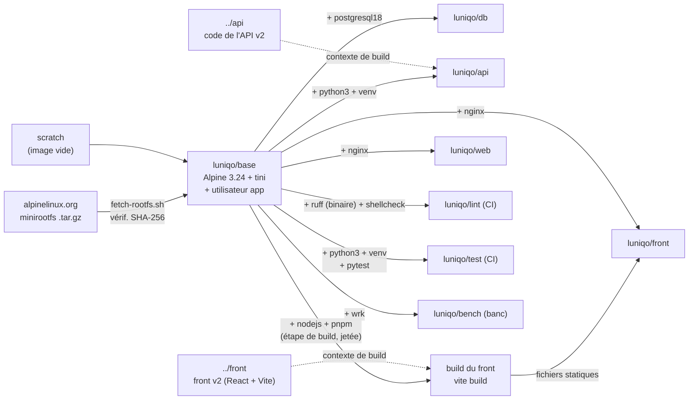
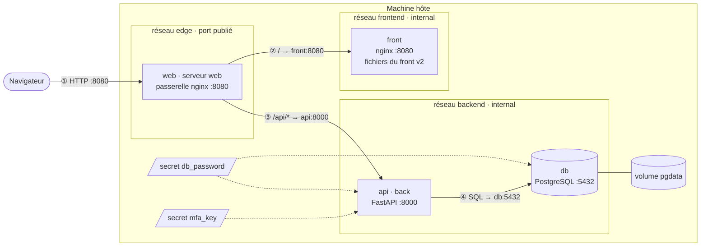
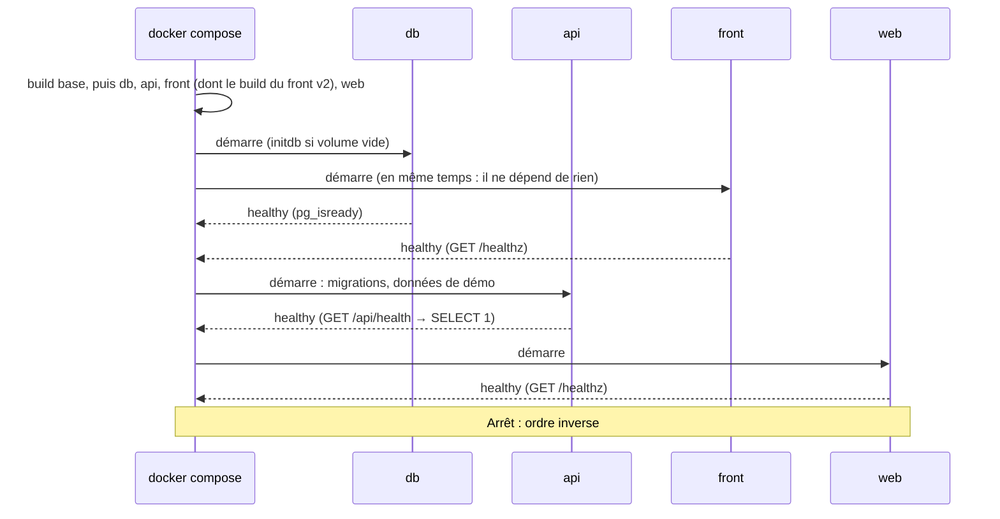
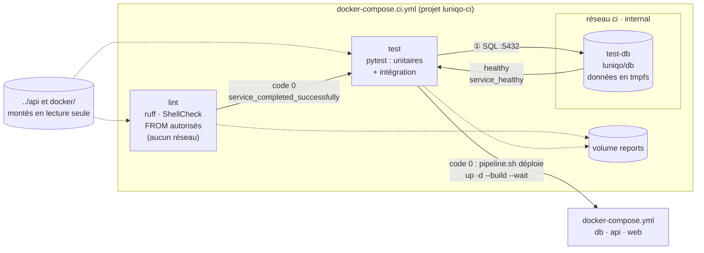

# TP Docker : Luniqo dans mon propre cloud, sans Docker Hub

[Luniqo](../README.md) est un logiciel de gestion de crèches. Ce TP, rangé
dans `docker/` du dépôt [Luniqo](https://github.com/zharrow/Luniqo),
le fait tourner dans une architecture de conteneurs orchestrés
avec docker compose : une **passerelle web** (nginx), le **front v2**
(React + Vite, servi par son propre nginx), une **API** (FastAPI) et une
**base de données** (PostgreSQL), plus deux conteneurs de CI (lint, tests) et
un générateur de charge pour le banc de mesure. Toutes les images sont
construites à partir de rien (`FROM scratch`) : **aucune image ne vient de
Docker Hub**.

> **Rendu du TP** : le dernier commit avant la date butoir, qui comprend la
> consigne supplémentaire (conteneurs de CI). Le sujet initial a été rendu au
> tag [`tp-docker-v1`](https://github.com/zharrow/Luniqo/tree/tp-docker-v1/docker),
> où le front était le serveur Next.js de la v1. Depuis
> [ADR-002](../M2/decisions/ADR-002-front-v2.md), le front v2 est une application
> monopage : l'image [`front`](front/README.md) construit ses fichiers et les sert
> avec un nginx dédié, et la passerelle `web` les relaie (LUN-117).

| Exigence du sujet | Réponse |
|---|---|
| 0 image Docker Hub, images personnalisées | 8 images construites depuis `scratch` : 5 pour la pile, 3 pour la CI et le banc ([détail](#zéro-image-docker-hub)) ; refus de toute autre image vérifié à chaque passage du [lint](lint/README.md) |
| Au moins un front, un back, un serveur web | **`front`** (front v2 React + Vite, servi par nginx), **`api`** (back FastAPI), **`web`** (serveur web : passerelle nginx), plus `db` (PostgreSQL) |
| Arguments de ressources au run et dans le compose | `.env` → `docker-compose.yml` → limites cgroups + arguments applicatifs ([détail](#orchestration)) |
| Consigne supplémentaire : au moins 2 conteneurs d'orchestration ou de CI/CD (scaling, lint, test) | **`lint`** et **`test`** (plus une base de test jetable), enchaînés par `pipeline.sh` : lint → tests → déploiement de la pile ([détail](#intégration-continue-en-conteneurs)) |
| Benchmark de la consommation CPU des conteneurs | `bench/bench.sh` et le générateur de charge **`bench`** : CPU de chaque conteneur au repos, sous charge et pendant la CI, et coût de Docker lui-même ([détail](#banc-de-mesure--consommation-cpu)) |

## Sommaire

1. [Démarrage rapide](#démarrage-rapide)
2. [Architecture](#architecture)
3. [Zéro image Docker Hub](#zéro-image-docker-hub)
4. [Les images](#les-images)
5. [Orchestration](#orchestration)
6. [Intégration continue en conteneurs](#intégration-continue-en-conteneurs) (consigne supplémentaire)
7. [Banc de mesure : consommation CPU](#banc-de-mesure--consommation-cpu)
8. [Docker face à la virtualisation classique](#docker-face-à-la-virtualisation-classique)
9. [Correspondance avec le barème](#correspondance-avec-le-barème)

## Démarrage rapide

Prérequis : Docker récent avec le plugin compose (Docker Desktop, OrbStack ou
Docker Engine), machine amd64 ou arm64, accès à internet pour le build (dépôts
Alpine, PyPI et npm). Testé avec Docker 29. Build du front v2 compris en
16,5 s sans cache (2026-10-27, Mac Apple Silicon, alors dans l'image `web`) ;
toute la pile en 9 s avec le cache (2026-10-29).

```sh
git clone https://github.com/zharrow/Luniqo.git && cd Luniqo/docker
docker compose up -d --build     # construit les images puis lance les services
docker compose ps                # db, api et web doivent être "healthy"
```

| Pour... | Faire |
|---|---|
| Ouvrir Luniqo (front v2) | <http://localhost:8080> (page de connexion) |
| Voir l'état de l'API | <http://localhost:8080/api/health> |
| Se connecter (données de démo) | `employe@demo.test` ou `direction@demo.test` (second facteur à enregistrer), avec le mot de passe `API_SEED_DEMO_PASSWORD` défini dans `../.env` ; sans lui, aucun compte de démonstration n'est créé |
| Documentation de l'API (Swagger) | <http://localhost:8080/api/docs> |
| Lire les logs | `docker compose logs -f` |
| Changer les ressources | modifier `.env` puis `docker compose up -d` |
| Lint, tests, puis déploiement si tout est vert | `./pipeline.sh` (`--no-deploy` : lint et tests seulement) |
| Mesurer la consommation CPU (pile démarrée) | `bench/bench.sh` |
| Tout arrêter | `docker compose down` (ajouter `-v` pour effacer la base) |

Port 8080 déjà pris sur la machine : `WEB_PUBLISHED_PORT=8081 docker compose up -d`.

La v1 (Next.js + Supabase Cloud) n'est plus dans la pile : elle reste en
production sur Vercel, gelée, jusqu'à la bascule vers la v2 (ADR-002).

## Architecture

### Arborescence

```
.
├── docker-compose.yml     orchestration des services
├── docker-compose.ci.yml  chaîne d'intégration : lint → test (+ base de test jetable)
├── docker-compose.bench.yml  générateur de charge du banc de mesure
├── pipeline.sh            lint → test → déploiement, comme un serveur de CI
├── .env                   arguments de ressources de chaque conteneur
├── secrets/
│   ├── db_password.dev    mot de passe de développement de la base (secret Docker)
│   └── mfa_key.dev        clé de développement qui chiffre les secrets TOTP (secret Docker)
├── base/                  image de base : Alpine depuis scratch + tini + utilisateur app
├── db/                    PostgreSQL 18
├── api/                   image de l'API FastAPI (le code est dans ../api)
├── front/                 front v2 : construit les fichiers (../front) et les sert avec nginx
├── web/                   passerelle nginx, seul point d'entrée : relaie vers front et api
├── lint/                  CI : ruff, ShellCheck, contrôle « zéro image Docker Hub »
├── test/                  CI : pytest, tests unitaires et d'intégration de l'API
└── bench/                 banc de mesure CPU (bench.sh) et générateur de charge (wrk)
```

Chaque dossier d'image contient un `README.md` qui détaille ses dépendances,
ses manipulations sur l'OS, ses arguments, son entrypoint, sa gestion des
signaux et son healthcheck.

### Construction des images



| Image | Taille | Contenu ajouté |
|---|---|---|
| `luniqo/base:1.0` | 23 Mo | Alpine (BusyBox, apk), tini, utilisateur `app`, outils `tp-resources` et `common.sh` |
| `luniqo/db:1.0` | 83 Mo | PostgreSQL 18.6 |
| `luniqo/api:0.1` | 186 Mo | Python 3.14, FastAPI, SQLAlchemy, psycopg, Alembic, le code de l'API |
| `luniqo/front:2.0` | 28 Mo | nginx 1.30, modèle de configuration et en-têtes du front, fichiers du front v2 (19 fichiers, 636 Kio). Ni Node.js ni sources : ils ne servent qu'à l'étape de build |
| `luniqo/web:3.0` | 27 Mo | nginx 1.30, modèle de configuration, page d'indisponibilité |
| `luniqo/lint:1.0` | 83 Mo | ruff 0.16.10 (binaire seul, 21,6 Mo), ShellCheck 0.11 (21,1 Mo), script `lint.sh`. Ni Python ni pip |
| `luniqo/test:1.0` | 278 Mo | Python 3.14, dépendances de l'API et outils de test (pytest, httpx2), lanceur `run_pytest.py`. Le code est monté au run, pas copié |
| `luniqo/bench:1.0` | 28 Mo | wrk 4.2.0, script `charge.sh` |

Au tag `tp-docker-v1`, l'image `luniqo/front:1.0` (serveur Next.js de la v1)
pesait 302 Mo.

### Schéma des communications



| # | De | Vers | Protocole | Réseau | Rôle |
|---|---|---|---|---|---|
| ① | navigateur | web `:8080` | HTTP | hôte → `edge` | seul point d'entrée |
| ② | web | front `:8080` | HTTP | `frontend` | nginx relaie tout ce qui n'est pas `/api/` : pages et fichiers du front v2, avec les en-têtes posés par le front (CSP, cache) |
| ③ | web | api `:8000` | HTTP | `backend` | nginx relaie `/api/*` ; le front appelle l'API sur la même origine, le cookie de session `HttpOnly` part de lui-même |
| ④ | api | db `:5432` | PostgreSQL | `backend` | requêtes SQL, migrations au démarrage |

Les conteneurs se trouvent par leur **nom de service** grâce au DNS interne de
Docker : aucune adresse IP n'est écrite en dur.

### Réseaux

| Réseau | Type | Membres | Pourquoi |
|---|---|---|---|
| `edge` | bridge | web | Réseau d'où part le port publié sur l'hôte. |
| `frontend` | bridge, `internal: true` | web, front | Le front n'est joint que par la passerelle : ni port publié, ni accès à internet, ni accès à l'API ou à la base (vérifié le 2026-10-29). |
| `backend` | bridge, `internal: true` | web, api, db | Communications internes. `internal` coupe toute sortie vers l'extérieur : l'API et la base sont **injoignables depuis l'hôte et sans accès à internet**. |

Vérifié :

```
$ curl localhost:8000          # API, depuis l'hôte
curl: (7) Failed to connect to localhost port 8000 after 0 ms: Couldn't connect to server
$ curl localhost:5432          # base, depuis l'hôte
curl: (7) Failed to connect to localhost port 5432 after 0 ms: Couldn't connect to server
$ docker compose exec api python -c "import urllib.request; urllib.request.urlopen('http://example.com')"
urllib.error.URLError: <urlopen error [Errno -3] Try again>
```

## Zéro image Docker Hub

| Endroit où Docker Hub pourrait intervenir | Ce qu'on fait à la place |
|---|---|
| `FROM alpine` / `FROM python` / `FROM postgres` / `FROM nginx` | `FROM scratch` + l'archive minirootfs téléchargée depuis le site d'Alpine (`base/`). Les autres images partent de `luniqo/base`. |
| `# syntax=docker/dockerfile:1` en tête de Dockerfile | Absente : elle téléchargerait le frontend de build depuis Docker Hub. |
| `image: postgres` dans le compose | Chaque service a une section `build:` et `pull_policy: build` : compose construit toujours et ne tente jamais de pull. |
| `FROM luniqo/base:1.0` avant que l'image existe | `additional_contexts: luniqo/base:1.0: service:base` : compose construit d'abord `base` et la fournit directement aux autres builds. |

Téléchargements faits pendant le build, aucun n'étant une image : paquets
Alpine (`apk`), paquets Python (PyPI) et paquets JavaScript (npm, versions du
`pnpm-lock.yaml`). La police du front est un paquet npm, servie par nginx.

Vérifiable : `grep FROM */Dockerfile` ne montre que `scratch`, une étape interne
(`rootfs-${TARGETARCH}`, `build`) ou `luniqo/base:1.0`, et
`docker compose config --images` ne liste que nos 5 images `luniqo/*` (de même
pour `-f docker-compose.ci.yml` et `-f docker-compose.bench.yml`).

**Vérifié automatiquement** depuis la consigne supplémentaire : le conteneur
[lint](lint/README.md) refuse tout `FROM` qui ne vise pas `scratch`, une image
`luniqo/*` ou une étape du même Dockerfile. Une image Docker Hub ajoutée par
erreur arrête la chaîne avant le déploiement.

## Les images

| Image | Rôle | Dépendances | Port | Arguments de l'application | Signal d'arrêt |
|---|---|---|---|---|---|
| [base](base/README.md) | socle commun | `tini` | | (build) `ALPINE_VERSION` | |
| [web](web/README.md) | **serveur web** : passerelle, relaie le front et l'API | `nginx` | 8080 (publié) | `NGINX_WORKER_PROCESSES`, `NGINX_WORKER_CONNECTIONS`, `FRONT_ADDR`, `API_ADDR` | `SIGQUIT` |
| [front](front/README.md) | **front** : application v2 (React + Vite) | `nginx` (+ `nodejs`, `pnpm` à l'étape de build) | 8080 | `NGINX_WORKER_PROCESSES`, `NGINX_WORKER_CONNECTIONS` | `SIGQUIT` |
| [api](api/README.md) | **back** : API | `python3` + venv | 8000 | `API_WORKERS`, `DB_POOL_SIZE`, `DB_ADDR`, `DB_NAME`, `DB_USER`, `DB_PASSWORD_FILE`, `SEED_DEMO` | `SIGTERM` |
| [db](db/README.md) | base de données | `postgresql18` | 5432 | `DB_NAME`, `DB_USER`, `DB_PASSWORD_FILE`, `DB_MAX_CONNECTIONS`, `DB_SHARED_BUFFERS` | `SIGINT` |
| [lint](lint/README.md) | **CI** : lint | `ruff` (binaire seul), `shellcheck` | aucun réseau | `LINT_RUFF_FORMAT` | `SIGTERM` (`tini -g`) |
| [test](test/README.md) | **CI** : tests | `python3` + venv (dépendances de l'API, pytest) | | `TEST_DB_ADDR`, `TEST_DB_NAME`, `TEST_DB_USER`, `TEST_DB_PASSWORD_FILE`, `TEST_STOP_TIMEOUT`, `PYTEST_ADDOPTS` | `SIGINT` |
| [bench](bench/README.md) | générateur de charge du banc | `wrk` | | `BENCH_URL`, `BENCH_DURATION`, `BENCH_CONNECTIONS`, `BENCH_THREADS` | `SIGINT` (`tini -g`) |

Les trois dernières ne sont pas des services : elles font leur travail une
fois et s'arrêtent, et leur **code de sortie** est le résultat.

Choix communs :

- **Utilisateur non-root** (`app`, uid 10001) pour tous les services.
- **Entrypoint en trois temps** : `tini` (PID 1, relaie les signaux) →
  `entrypoint.sh` (vérifie les arguments, affiche les ressources, prépare) →
  `exec` du programme, qui reçoit directement les signaux.
- **Arguments vérifiés** : une valeur invalide arrête le conteneur avec un
  message clair (code 64) plutôt que de le laisser tourner mal configuré.
- **Healthcheck qui teste vraiment le service** (requête HTTP, `pg_isready`,
  `SELECT 1`), utilisé par compose pour l'ordre de démarrage.

## Orchestration

### Les arguments traduits dans le compose

Tous les réglages sont dans [`.env`](.env), lu automatiquement par compose.
`docker-compose.yml` les injecte avec `${VARIABLE:-défaut}` : il reste
utilisable sans `.env`.

| `.env` | Dans `docker-compose.yml` | Équivalent `docker run` |
|---|---|---|
| `DB_CPUS=1.0` / `DB_MEMORY=256M` / `DB_PIDS=48` | `deploy.resources.limits` | `--cpus 1.0 --memory 256m --pids-limit 48` |
| `DB_MAX_CONNECTIONS=20` | `environment: DB_MAX_CONNECTIONS` | `-e DB_MAX_CONNECTIONS=20` |
| `DB_SHARED_BUFFERS=64MB` | `environment: DB_SHARED_BUFFERS` | `-e DB_SHARED_BUFFERS=64MB` |
| `DB_PASSWORD_FILE` (optionnel) | `secrets: db_password: file:` | `-v fichier:/run/secrets/db_password:ro` |
| `MFA_KEY_FILE` (optionnel) | `secrets: mfa_key: file:` | `-v fichier:/run/secrets/mfa_key:ro` |
| `API_CPUS=0.5` / `API_MEMORY=128M` / `API_PIDS=32` | `deploy.resources.limits` | `--cpus 0.5 --memory 128m --pids-limit 32` |
| `API_WORKERS=1` | `environment: API_WORKERS` | `-e API_WORKERS=1` |
| `API_DB_POOL_SIZE=8` | `environment: DB_POOL_SIZE` | `-e DB_POOL_SIZE=8` |
| `API_SEED_DEMO=true` | `environment: SEED_DEMO` | `-e SEED_DEMO=true` |
| `FRONT_CPUS=0.25` / `FRONT_MEMORY=32M` / `FRONT_PIDS=16` | `deploy.resources.limits` | `--cpus 0.25 --memory 32m --pids-limit 16` |
| `FRONT_WORKER_PROCESSES=1` / `FRONT_WORKER_CONNECTIONS=512` | `environment: NGINX_WORKER_*` | `-e NGINX_WORKER_PROCESSES=1 ...` |
| `WEB_CPUS=0.25` / `WEB_MEMORY=32M` / `WEB_PIDS=16` | `deploy.resources.limits` | `--cpus 0.25 --memory 32m --pids-limit 16` |
| `WEB_WORKER_PROCESSES=1` / `WEB_WORKER_CONNECTIONS=512` | `environment: NGINX_WORKER_*` | `-e NGINX_WORKER_PROCESSES=1 ...` |
| `WEB_PUBLISHED_PORT=8080` | `ports: "8080:8080"` | `-p 8080:8080` |
| `LINT_CPUS=1.0` / `LINT_MEMORY=128M` / `LINT_PIDS=16` | `docker-compose.ci.yml`, `deploy.resources.limits` | `--cpus 1.0 --memory 128m --pids-limit 16` |
| `LINT_RUFF_FORMAT=concise` | `environment: LINT_RUFF_FORMAT` | `-e LINT_RUFF_FORMAT=concise` |
| `TEST_CPUS=1.0` / `TEST_MEMORY=512M` / `TEST_PIDS=32` | `docker-compose.ci.yml`, `deploy.resources.limits` | `--cpus 1.0 --memory 512m --pids-limit 32` |
| `TEST_STOP_TIMEOUT=5` | `environment: TEST_STOP_TIMEOUT` | `-e TEST_STOP_TIMEOUT=5` |
| `TEST_DB_CPUS=1.0` / `TEST_DB_MEMORY=256M` / `TEST_DB_PIDS=48` | `docker-compose.ci.yml`, `deploy.resources.limits` | `--cpus 1.0 --memory 256m --pids-limit 48` |
| `TEST_DB_TMPFS=128m` | `tmpfs: /var/lib/postgresql/data:size=` | `--tmpfs /var/lib/postgresql/data:size=128m` |
| `TEST_DB_MAX_CONNECTIONS=30` / `TEST_DB_SHARED_BUFFERS=32MB` | `environment: DB_*` | `-e DB_MAX_CONNECTIONS=30 ...` |
| `BENCH_CPUS=1.0` / `BENCH_MEMORY=32M` / `BENCH_PIDS=8` | `docker-compose.bench.yml`, `deploy.resources.limits` | `--cpus 1.0 --memory 32m --pids-limit 8` |

Les adresses entre services (`API_ADDR=api:8000`, `DB_ADDR=db:5432`...) sont
écrites dans le compose : elles découlent des noms de services.

### Les limitations de ressources, conteneur par conteneur

Trois limites appliquées par le noyau via les **cgroups** : `cpus` (temps CPU,
le conteneur est ralenti au-delà), `memory` (au-delà, le noyau tue le processus
et `restart: unless-stopped` le relance), `pids` (processus **et threads** :
protège contre un emballement).

Mesures du 2026-10-08 (`docker stats`, Mac Apple Silicon sous OrbStack) :

| Service | CPU | Mémoire | PIDs | Au repos | Sous charge | Justification |
|---|---|---|---|---|---|---|
| db | 1.0 | 256 Mo | 48 | 20 à 45 Mo, 11 pids | 32 Mo, 18 pids, 12 % CPU | Les requêtes SQL sont le travail le plus coûteux. `shared_buffers` = 25 % de la mémoire. Un processus par connexion : `pids` couvre `max_connections` (20) + processus de fond. |
| api | 0.5 | 128 Mo | 32 | 69 Mo, 3 pids | 73 Mo, 6 pids, 49 % CPU | Un worker pour un demi-cœur. Routes asynchrones : aucune création de thread par requête. |
| web | 0.25 | 32 Mo | 16 | 3 à 5 Mo, 3 pids | 4 à 6 Mo, 3 pids, 6 % CPU | nginx ne fait que relayer. 2026-10-29, en relais du front : 2,5 à 3,4 Mo, 0,24 cœur (95 % de sa limite) à 11 900 pages/s : c'est elle le goulot des pages. |
| front | 0.25 | 32 Mo | 16 | 2,4 à 3,0 Mo, 0,004 cœur | 2,4 à 2,9 Mo, 0,19 à 0,20 cœur (77 à 79 %) | nginx sert des fichiers statiques : c'est le conteneur sollicité par les pages. |

Charges : 3 000 requêtes `/api/v2/nurseries` (route alors ouverte ; protégée par session depuis LUN-004) à 60 simultanées (db, api, web) ; front et web mesurés le 2026-10-29 par le [banc de mesure](#banc-de-mesure--consommation-cpu).
Au tag `tp-docker-v1`, le serveur Next.js (`front:1.0`) occupait 72 à 151 Mo
et jusqu'à un cœur entier : le front v2 n'a plus de serveur applicatif, nginx
sert ses fichiers.

Total : 2 cœurs et 448 Mo au maximum, pour une consommation réelle au repos
d'environ 130 Mo (2026-10-29, fin de la phase de repos du banc : api 89 Mo, db 35 Mo, front et web 3 Mo chacun).

Débit mesuré, sans aucune erreur : 3 000 requêtes d'API en 8,8 s (environ 340
par seconde). L'API plafonne alors à 49 % de CPU, c'est-à-dire **exactement sa
limite de 0,5 cœur** : c'est elle le goulot, pas la base (12 %), et la limite
joue son rôle. Pour monter en charge, on
augmente ensemble `API_CPUS` et `API_WORKERS` (un worker par demi-cœur à un
cœur), puis `API_DB_POOL_SIZE` et `DB_MAX_CONNECTIONS` en conséquence.

**Les arguments de l'application suivent les limites Docker.** Une limite seule
ne suffit pas : un programme qui ne la connaît pas se comporte comme s'il avait
toute la machine. PostgreSQL ouvrirait 100 connexions (100 processus) et
réserverait 128 Mo de cache ; nginx en `auto` lancerait un worker par cœur de
l'hôte ; FastAPI ouvre par défaut un pool de 40 threads. Les tests de charge
l'ont montré concrètement : avec la limite `pids` à 32, la première version de
l'API renvoyait **2 697 erreurs sur 3 000 requêtes** (`can't start new thread`).
La version asynchrone les sert toutes (détail dans [api/README.md](api/README.md#ce-que-les-mesures-ont-fait-changer)).

**Le mot de passe de la base est un secret, pas une variable.** Il est monté en
fichier dans `/run/secrets/db_password` et n'apparaît ni dans `docker inspect`
ni dans l'environnement des processus. Compose refuse un secret issu d'une
variable d'environnement sur un conteneur en lecture seule (`file is the sole
supported option`), d'où le fichier `secrets/db_password.dev`. C'est une valeur
de développement, versionnée pour que le projet démarre tel quel. Hors TP,
`DB_PASSWORD_FILE` pointe vers un fichier hors du dépôt. La clé qui chiffre les
secrets TOTP (`secrets/mfa_key.dev`, LUN-006) suit le même principe, avec
`MFA_KEY_FILE`.

### Gestion de SIGTERM

À l'arrêt, Docker envoie le signal d'arrêt de l'image, attend
`stop_grace_period`, puis envoie `SIGKILL`. Trois mécanismes : **tini** en PID 1
relaie le signal ; la **forme exec** et le `exec "$@"` des entrypoints évitent
qu'un shell l'avale ; **chaque programme l'intercepte** et s'arrête proprement.

| Service | Signal | Ce que fait le programme | `stop_grace_period` | Arrêt mesuré |
|---|---|---|---|---|
| web | `SIGQUIT` | nginx termine les requêtes en cours puis s'arrête (`SIGTERM` serait un arrêt brutal pour nginx). | 10 s | < 1 s, code 0 |
| api | `SIGTERM` | uvicorn refuse les nouvelles connexions, termine les requêtes en cours (10 s au plus), puis l'application ferme son pool de connexions. | 15 s | < 1 s, code 143 (*) |
| db | `SIGINT` | « fast shutdown » : transactions annulées, point de reprise écrit, arrêt. `SIGTERM` attendrait la déconnexion de tous les clients. | 30 s | < 1 s, code 0 |
| front | `SIGQUIT` | Même nginx que web : il termine les requêtes en cours puis s'arrête. Pendant ce temps, la passerelle affiche sa page d'indisponibilité. | 10 s | 0,32 s, code 0 |
| lint | `SIGTERM` | `tini -g` envoie le signal au script **et** à l'outil en cours (ruff ou ShellCheck), pas seulement au script. | 5 s | 0,17 s, code 143 |
| test | `SIGINT` | pytest s'interrompt comme sur un Ctrl-C : nettoyage des fixtures, rapport JUnit écrit, code 2. Un blocage trouvé dans les threads d'anyio a été corrigé ([détail](test/README.md#le-blocage-trouvé-et-sa-correction)). | 15 s | 10 essais sur 10 propres, < 1 s (une fois 5,2 s) |
| test-db | `SIGINT` | Même image que db. | 10 s | 0,15 s, code 0 |
| bench | `SIGINT` | wrk arrête la charge et affiche quand même ses statistiques ; SIGTERM le tuerait sans résultat. | 5 s | 0,33 s, code 0, statistiques affichées |

(*) Après un arrêt propre, uvicorn se renvoie le signal reçu pour que son parent
sache pourquoi il s'est arrêté : le code vaut alors 128 + 15. Un `SIGKILL` aurait
donné 137, au bout de 15 s. Les logs montrent l'arrêt complet :

```
$ docker compose stop            (0,7 s au total pour les 4 services)
api-1  | INFO:     Shutting down
api-1  | INFO:     Application shutdown complete.
db-1   | LOG:  received fast shutdown request
db-1   | LOG:  database system is shut down
```

### Dépendances entre conteneurs et ordre de démarrage



| Dépendance | Condition | Pourquoi |
|---|---|---|
| api → db | `service_healthy`, `restart: true` | L'API applique les migrations au démarrage : la base doit répondre. `restart: true` relance l'API quand compose recrée la base. |
| web → front | `service_healthy` | La passerelle n'ouvre qu'une fois les pages disponibles. |
| web → api | `service_healthy` | La passerelle n'ouvre qu'une fois l'API prête. Elle résout les noms à chaque requête : elle démarrerait sans elle, mais `/api/` servirait la page d'indisponibilité. |

Démarrage mesuré le 2026-10-29 : 24,2 s pour les 4 services depuis un volume
vide, 19,0 s avec des données existantes (18,5 s au tag `tp-docker-v1`). Arrêt
de toute la pile : 0,82 s, codes de sortie 0 (143 pour l'API, voir plus bas). L'essentiel est l'attente
des healthchecks (intervalle de 5 s).

**Panne de la base, mesurée** : base arrêtée, `/api/health` répond 503 en 1 s et
l'API passe `unhealthy` ; base relancée, l'API redevient `healthy` d'elle-même.

### Stockage

| Volume | Monté sur | Contenu |
|---|---|---|
| `pgdata` | db `/var/lib/postgresql/data` | Les données PostgreSQL. Survivent à `docker compose down` et à la reconstruction des images (vérifié : mêmes crèches après redémarrage, données de démo non réinsérées). Effacées seulement par `docker compose down -v`. |

### Sécurité (réglages communs, ancre `x-common`)

| Réglage | Effet |
|---|---|
| `read_only: true` | Système de fichiers de l'image en lecture seule. |
| `tmpfs: /tmp:size=16m` | Seul dossier modifiable hors volumes, en mémoire, borné. |
| `cap_drop: [ALL]` | Aucune *capability* Linux. |
| `security_opt: no-new-privileges:true` | Aucun gain de privilèges via un binaire setuid. |
| `USER app` (Dockerfiles) | Aucun processus en root. |
| réseau `backend` interne | API et base ni exposées ni capables de joindre internet. |
| secret Docker | Mot de passe hors des variables d'environnement. |
| en-têtes HTTP (web) | Front : politique de sécurité du contenu stricte (tout vient de Luniqo, aucun script en ligne), `X-Frame-Options: DENY`, `Permissions-Policy`, `nosniff`, `Referrer-Policy`, cache immuable des fichiers à empreinte. API : `nosniff`, `SAMEORIGIN`, `Referrer-Policy`. Version de nginx masquée partout. |

## Intégration continue en conteneurs

Consigne supplémentaire du sujet : au moins deux conteneurs associés à
l'orchestration ou à la CI/CD, parmi le scaling, le lint et les tests. Nous
avons retenu **lint** et **test**, qui contrôlent le vrai code de Luniqo et
décident ensemble du déploiement.

Chaque étape est un conteneur, et **le code de sortie est le contrat** : 0, la
suite peut démarrer ; autre chose, la chaîne s'arrête et rien n'est déployé.
`pipeline.sh` joue le rôle du serveur de CI (Jenkins, GitLab Runner, GitHub
Actions) :



| Conteneur | Image | Rôle | Réseau | Ressources (défaut) |
|---|---|---|---|---|
| `lint` | [luniqo/lint](lint/README.md) | ruff sur `api/` (règles de sécurité comprises), ShellCheck sur les scripts des images, contrôle « zéro image Docker Hub » sur les Dockerfiles | **aucun** (`network_mode: none`) | 1 cœur, 128 Mo, 16 pids |
| `test-db` | [luniqo/db](db/README.md) | PostgreSQL jetable pour les tests d'intégration ; données en tmpfs, détruites avec le conteneur | `ci` (interne) | 1 cœur, 256 Mo tmpfs compris, 48 pids |
| `test` | [luniqo/test](test/README.md) | 543 tests de l'API (pytest), dont les tests d'intégration sur `test-db` | `ci` (interne) | 1 cœur, 512 Mo, 32 pids |

| # | De | Vers | Protocole | Réseau | Rôle |
|---|---|---|---|---|---|
| ① | test | test-db `:5432` | PostgreSQL | `ci` (`internal: true`) | migrations, puis une transaction annulée par test |

Ni `lint` ni `test` n'ont accès à internet, et rien n'est joignable depuis
l'hôte.

### Lancer la chaîne

```sh
./pipeline.sh                    # lint → test → déploiement de la pile si tout est vert
./pipeline.sh --no-deploy        # lint → test seulement
docker compose -f docker-compose.ci.yml run --rm lint     # une étape seule
PYTEST_ADDOPTS="-x -k cleaning" ./pipeline.sh --no-deploy # options de pytest
```

Les rapports (`ruff.txt`, `shellcheck.txt`, `images.txt`, `pytest.xml` au
format JUnit) sont recopiés dans `docker/reports/`, comme les « artefacts »
d'une CI.

Mesuré le 2026-10-29 sur `develop` : chaîne verte en 88 s (lint 0,7 s de CPU,
543 tests en 50 s), puis pile déployée et saine. Les échecs ont été provoqués
volontairement pour vérifier les barrières :

| Défaut introduit | Résultat |
|---|---|
| `FROM python:3.12-alpine` dans un Dockerfile | `lint=1 test=absent` : le test ne démarre pas, rien n'est déployé |
| Un test faux (`assert 1 + 1 == 3`) | `lint=0 test=1` : rien n'est déployé, la version en place continue de tourner |
| `docker stop` pendant les tests | code 2, rapport JUnit écrit ([détail](test/README.md#gestion-des-signaux-darrêt)) |

### Dépendances et ordre de démarrage

| Dépendance | Condition | Pourquoi |
|---|---|---|
| test → lint | `service_completed_successfully` | Le test ne démarre qu'après un lint **terminé avec le code 0**. C'est la barrière de la chaîne. |
| test → test-db | `service_healthy` | Les tests d'intégration appliquent les migrations dès le début : la base doit répondre (`pg_isready`). |
| déploiement → test | dans `pipeline.sh` | La pile n'est reconstruite et relancée que si lint et test ont rendu 0. |

**Piège mesuré : ne pas se fier au code de `docker compose up`.** Avec Compose
5.5.0, `docker compose up --abort-on-container-failure lint test` rend **0**
quand le lint échoue et que la chaîne est interrompue. Un script qui s'y fie,
comme l'exemple fourni avec le sujet, déclarerait la chaîne réussie.
`pipeline.sh` lit donc le code de sortie de chaque conteneur
(`docker compose ps -a`), et considère une étape qui n'a pas tourné comme un
échec.

### Choix

| Choix | Pourquoi |
|---|---|
| Lint et test plutôt que le scaling | Ils contrôlent le vrai code du projet et protègent le déploiement. Le scaling de l'exemple du cours demande Docker Swarm, qui ignore `build`, `depends_on` et `additional_contexts`, sur lesquels repose toute la pile. Il faut aussi monter le socket Docker dans un conteneur, ce qui revient à lui donner un accès root à l'hôte. Enfin, l'API applique ses migrations au démarrage : plusieurs répliques les lanceraient en même temps. |
| Compose séparé (`docker-compose.ci.yml`) | Les conteneurs de CI s'exécutent une fois (`restart: "no"`), la pile tourne en continu. Les mélanger obligerait à exclure la CI de chaque `docker compose up`. |
| Code monté en lecture seule, pas copié | La même image vérifie n'importe quelle version du code, et une étape de CI ne peut pas modifier ce qu'elle contrôle. |
| Versions de ruff et pytest lues dans `api/requirements-dev.txt` | Mêmes versions que la CI GitHub et les postes de développement : un seul fichier fait foi. |
| Base de test dédiée, en mémoire | Jamais la base de la pile (le nom doit finir par `_test`, les tests la vident) ; rien ne survit au passage. |
| Mot de passe de `test-db` : toujours `secrets/db_password.dev` | Même si `DB_PASSWORD_FILE` désigne le secret d'un vrai déploiement, il ne finit jamais dans une base jetable. |

La CI GitHub (`.github/workflows/ci.yml`) lance aussi cette chaîne à chaque PR
(job « Chaîne de CI en conteneurs ») : les images de CI sont construites et
éprouvées en continu, pas seulement sur un poste.

## Banc de mesure : consommation CPU

Demandé en cours : mesurer la consommation CPU due aux conteneurs.
[`bench/bench.sh`](bench/bench.sh) lit le **temps CPU exact** de chaque
conteneur (compteur `usage_usec` de son cgroup, avant et après chaque phase) et
celui de la VM qui fait tourner Docker sur le Mac. La charge est envoyée par
wrk depuis l'image maison [`luniqo/bench`](bench/README.md), sur le réseau de
la pile. Méthode complète, image du générateur et limites de la mesure :
[bench/README.md](bench/README.md).

Résultats `[RÉEL]` du 2026-10-29, trois passages, Mac Apple M4 (10 cœurs),
OrbStack. Pile actuelle (5 images : db, api, front, web, avec connexions
persistantes de la passerelle) :

| Phase | Pile (total) | Conteneur le plus sollicité | VM Docker | Coût de Docker (VM − conteneurs) | Débit |
|---|---|---|---|---|---|
| Repos, 30 s | 0,02 cœur | api 0,007 | 0,07 cœur | 0,05 cœur | |
| Charge API (`/api/health`) | 0,54 cœur | **api 0,47 à 0,48, 95 % de sa limite de 0,5** | 0,71 | 0,15 à 0,16 | 399 à 520 req/s |
| Charge front v2 (`/connexion`) | 0,44 cœur | **web 0,24, 95 % de sa limite de 0,25** ; front 0,19 à 0,20 (78 %) | 1,06 à 1,08 | 0,45 à 0,47 | 11 600 à 11 900 req/s |
| Chaîne de CI (lint + 543 tests, 58 à 59 s) | 0,02 cœur | test 0,79 en moyenne (46 s de CPU) | 1,00 à 1,02 | 0,10 | |

Ce qu'on en retient :

- **Au repos, les conteneurs ne coûtent presque rien** : 0,02 cœur pour toute
  la pile, 0,07 pour la VM Docker entière. Une VM classique ferait tourner un
  système complet par service.
- **Les limites `cpus` jouent leur rôle** : sous charge, le conteneur sollicité
  plafonne à 95 % de sa limite, à chaque passage, et les autres ne sont pas
  touchés.
- **Le coût de Docker suit le trafic réseau, pas le calcul** : environ 12 % en
  plus du travail des conteneurs pour les tests, 29 % sous charge API, 76 % à
  11 800 petites requêtes par seconde, qui traversent deux fois le réseau
  virtuel (passerelle puis front). Ce travail est compté hors des conteneurs.
- **La mesure a corrigé la passerelle.** Avec le front dans son propre
  conteneur, la première version de `web` ouvrait une connexion vers lui à
  chaque requête : 822 à 882 pages/s. Avec des connexions persistantes
  (`upstream` + `keepalive`, [détail](web/README.md#résolution-des-services-et-connexions-persistantes)) :
  11 600 à 11 900. C'est 18 % de moins que lorsque `web` servait lui-même ces
  fichiers (14 300 à 14 700 pages/s, deux nginx au lieu d'un) : le prix,
  mesuré, d'une image front distincte.
- **Le front v2 coûte environ 150 fois moins de CPU par page** que l'ancien
  front Next.js : 37 µs pour les deux nginx, contre 5,8 ms de rendu serveur
  (163 à 183 pages/s pour un cœur entier, pile du commit `3532e25`).

Les mesures des étapes précédentes (front Next.js ; front servi par `web` ;
front distinct sans connexions persistantes) sont gardées dans
[bench/resultats/](bench/resultats/), chacune avec son commit.

Mesures à refaire sur le VPS (Linux, sans VM) quand il existera.

## Docker face à la virtualisation classique

Une machine virtuelle émule une machine complète, avec son propre noyau et son
propre système d'exploitation. Un conteneur est un processus du système hôte,
isolé par le noyau (*namespaces* pour ce qu'il voit, *cgroups* pour ce qu'il
consomme).

| | Ce projet en conteneurs | Le même projet en VM |
|---|---|---|
| Taille | 23 Mo de base partagée + 6 à 163 Mo par image | Un OS complet par VM, de l'ordre du Go chacune |
| Démarrage | 18,5 s pour toute la pile (mesure du tag `tp-docker-v1`), surtout l'attente volontaire des healthchecks | Démarrage d'un OS complet par VM |
| Mémoire au repos | Environ 130 Mo pour les quatre services (mesuré le 2026-10-29) | Chaque VM réserve la mémoire de son propre OS |
| Limites | Une ligne par limite, modifiable en recréant le conteneur | Fixées à la création de la VM |
| Reproductibilité | Dockerfiles et compose versionnés ; `docker compose up --build` recrée tout | Installation manuelle ou outillage supplémentaire (Packer, Ansible...) |
| Isolation | Noyau partagé : d'où le durcissement (non-root, `cap_drop`, lecture seule) | Noyau séparé : isolation plus forte |

En pratique, un cloud fait souvent tourner ses conteneurs dans des VM : c'est ce
que fera Luniqo sur son VPS.

## Correspondance avec le barème

| Critère | Où le trouver |
|---|---|
| Mise en forme du rendu | Ce README, un README par image, commentaires dans chaque Dockerfile et dans le compose |
| Explication des dépendances installées | « Dépendances installées » de [base](base/README.md), [db](db/README.md), [api](api/README.md), [front](front/README.md), [web](web/README.md), [lint](lint/README.md), [test](test/README.md), [bench](bench/README.md) |
| Explication des manipulations sur l'OS | « Manipulations sur l'OS » de chaque README d'image |
| Explication des arguments attendus | « Arguments attendus » de chaque README d'image |
| Explications sur les entrypoints choisis | « Entrypoint » de chaque README d'image + [choix communs](#les-images) |
| Arguments traduits dans docker compose | [Les arguments traduits dans le compose](#les-arguments-traduits-dans-le-compose), [`.env`](.env), [`docker-compose.yml`](docker-compose.yml) |
| Limitations de ressources expliquées | [Les limitations de ressources, conteneur par conteneur](#les-limitations-de-ressources-conteneur-par-conteneur) |
| SIGTERM gérés | [Gestion de SIGTERM](#gestion-de-sigterm) + « Gestion des signaux d'arrêt » de chaque image |
| Dépendances entre conteneurs | [Dépendances entre conteneurs et ordre de démarrage](#dépendances-entre-conteneurs-et-ordre-de-démarrage) |
| Schéma des communications | [Schéma des communications](#schéma-des-communications) (pile) et [chaîne de CI](#intégration-continue-en-conteneurs) |
| Consigne supp. : Docker pour le scaling ou la CI/CD (1) | Conteneur **lint** : [lint/README.md](lint/README.md), [Intégration continue en conteneurs](#intégration-continue-en-conteneurs) |
| Consigne supp. : Docker pour le scaling ou la CI/CD (2) | Conteneur **test** (et sa base `test-db`) : [test/README.md](test/README.md), [`docker-compose.ci.yml`](docker-compose.ci.yml), [`pipeline.sh`](pipeline.sh) |
| Benchmark CPU (demandé en cours) | [Banc de mesure : consommation CPU](#banc-de-mesure--consommation-cpu), [bench/README.md](bench/README.md), résultats bruts dans [bench/resultats/](bench/resultats/) |
